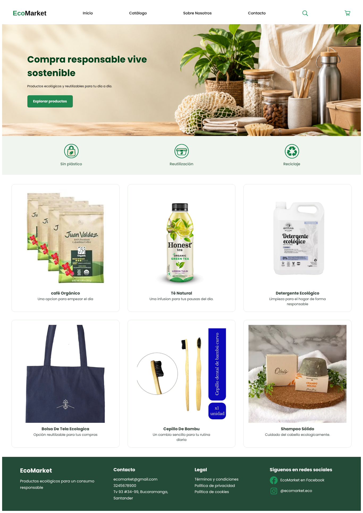
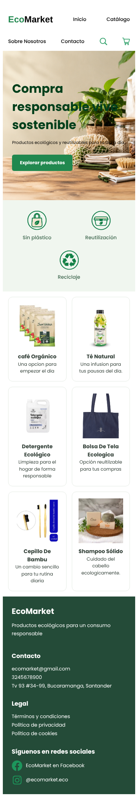
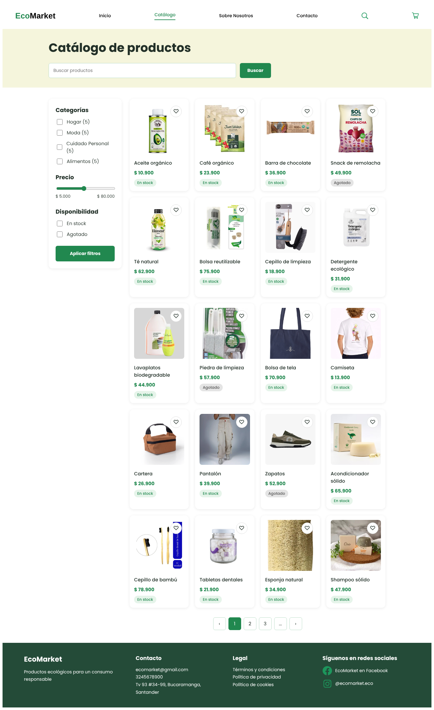
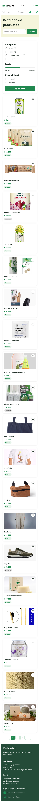
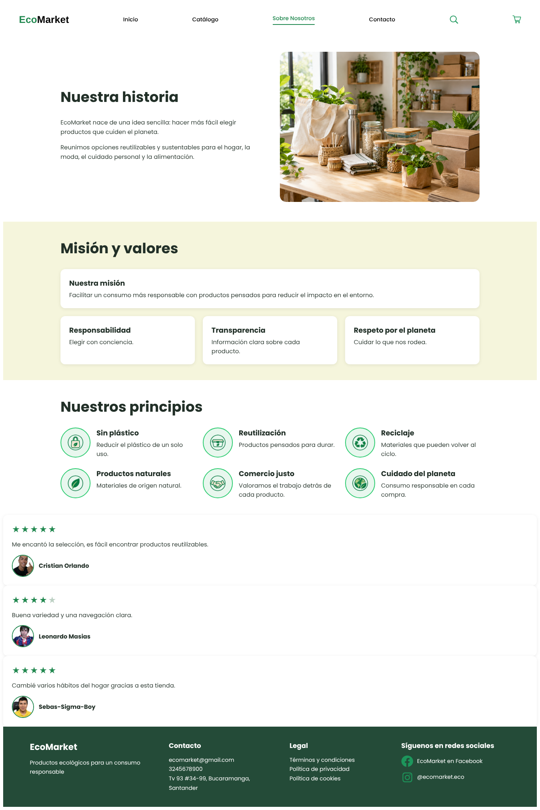
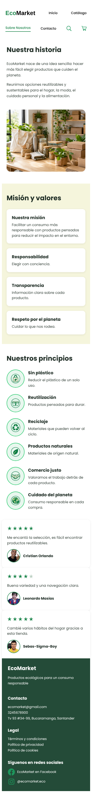
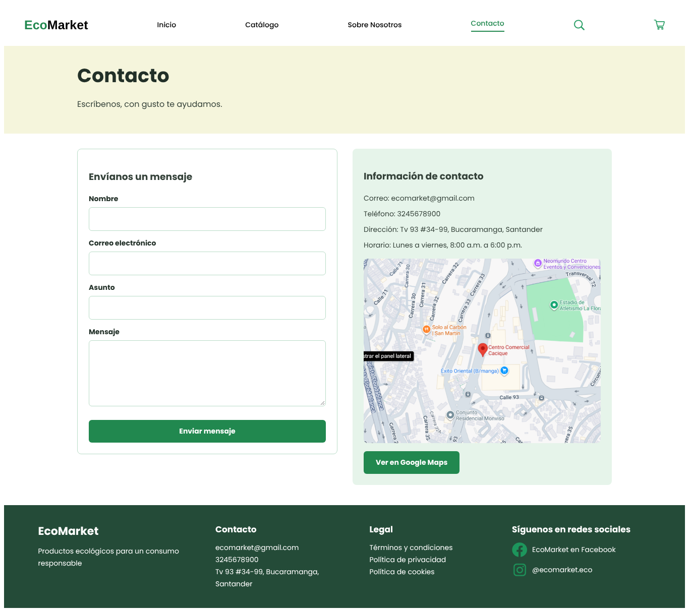
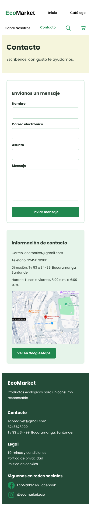

# EcoMarket_AndresLozano

Tienda en línea de productos ecológicos, reutilizables y sostenibles. Proyecto entregable de desarrollo web con HTML5 y CSS3.

**Sitio publicado:** [https://ecomarketandres.netlify.app/](https://ecomarketandres.netlify.app/)

## Descripción y objetivo

EcoMarket ofrece una experiencia de compra visualmente atractiva, accesible y fácil de navegar. El objetivo del proyecto es aplicar principios de diseño UX/UI, diseño responsivo (Mobile First) y organización del código, usando únicamente HTML5 y CSS3, sin JavaScript ni frameworks externos.

Como no se usa JavaScript, los filtros, el buscador, la paginación, los favoritos y el carrito son elementos visuales. El formulario de contacto solo valida de forma visual con `:valid` y `:invalid` y no envía los datos a un servidor.

## Vistas del sitio

- **Inicio** (`index.html`): encabezado, banner principal, productos destacados y pie de página.
- **Catálogo** (`views/productos.html`): filtros, buscador, 20 productos y paginación visual.
- **Sobre nosotros** (`views/sobre-nosotros.html`): historia, principios y testimonios.
- **Contacto** (`views/contacto.html`): formulario con validación visual, información y ubicación.

## Tecnologías utilizadas

- HTML5 semántico
- CSS3 (Flexbox, Grid, media queries, transiciones y pseudoclases)
- Git y GitHub (ramas por funcionalidad y Pull Requests)
- Netlify (publicación del sitio)

## Estructura del proyecto

```
EcoMarket/
├── css/
│   ├── main.css          (estilos generales, variables y tipografía)
│   ├── layout.css        (encabezado, pie de página y distribución)
│   ├── components.css    (tarjetas, botones y formularios)
│   └── animations.css    (transiciones y animaciones)
├── img/
│   ├── products/
│   ├── icons/
│   ├── hero/
│   ├── clientes/
│   ├── mockups/
│   └── capturas/
├── views/
│   ├── productos.html
│   ├── sobre-nosotros.html
│   └── contacto.html
├── index.html
└── README.md
```

## Cómo visualizar el sitio

1. Entra al enlace público: [https://ecomarketandres.netlify.app/](https://ecomarketandres.netlify.app/)
2. O descarga el repositorio y abre `index.html` en tu navegador. No necesita instalación ni servidor.

## Capturas

### Inicio

| Escritorio                                                  | Móvil                                             |
| ----------------------------------------------------------- | -------------------------------------------------- |
|  |  |

### Catálogo

| Escritorio                                                       | Móvil                                                  |
| ---------------------------------------------------------------- | ------------------------------------------------------- |
|  |  |

### Sobre nosotros

| Escritorio                                                                  | Móvil                                                             |
| --------------------------------------------------------------------------- | ------------------------------------------------------------------ |
|  |  |

### Contacto

| Escritorio                                                      | Móvil                                                 |
| --------------------------------------------------------------- | ------------------------------------------------------ |
|  |  |

## Autor

Andrés Felipe Lozano Ramírez
